<!-- Profile README for github.com/Eliza-05. All images are self-hosted SVGs in /assets (no external services). Generated by final.py. -->


  
  

I have completed my Systems Engineering coursework at Escuela Colombiana de Ingeniería Julio Garavito and am awaiting graduation. My work brings together software engineering, applied artificial intelligence, data analytics and intelligent automation, with a particular interest in scalable architectures, intelligent systems and technology that turns complex processes into practical solutions.

I approach engineering end to end, from architecture and development to integration, testing, security and deployment. In team projects I have owned backend services, real-time features and CI/CD pipelines. I value collaboration, analytical thinking and continuous learning.

Beyond technology, I enjoy football, working out at the gym and staying active. Sports are an important part of my life.

  <a href="https://github.com/Eliza-05/notihouse-pal"></a>
  <a href="https://github.com/Eliza-05/powershell-insight-ai"></a>
  <a href="https://github.com/Eliza-05/SecureDeps"></a>
  <a href="https://github.com/Eliza-05/smarthome-valuator-PTIA"></a>
  <a href="https://github.com/Eliza-05/urbanstyle-aida"></a>
  <a href="https://github.com/Eliza-05/geoprioriza-demo"></a>

<a href="https://github.com/DiNNo-team"></a>

<a href="https://github.com/ECIEXPRESSV2"></a>

<a href="https://github.com/Logiflow-Gavilanes-ECI"></a>





<b>Full skills list (text version)</b>

- **Programming Languages:** TypeScript, JavaScript, Python, Java, Bash, SQL, PowerShell.
- **Frontend & Mobile**
  - *Frameworks and libraries:* React, React Native, Angular, Ionic, Capacitor, Expo, TanStack Query, Tailwind CSS.
  - *Build tooling and web standards:* Vite, HTML, CSS.
- **Backend & APIs**
  - *Frameworks and runtimes:* NestJS, Node.js, Express, FastAPI, Spring Boot, Socket.IO.
  - *Messaging, build and API spec:* RabbitMQ, Apache Maven, OpenAPI.
  - *RPC framework:* gRPC.
  - *Protocols, patterns and practices:* REST APIs, WebSockets, Microservices, Event-driven architecture, Transactional outbox, API gateway.
- **Databases & Data Storage**
  - *Database engines:* PostgreSQL, MySQL, MongoDB, Redis.
  - *ORMs and schema tools:* Prisma, Drizzle ORM, TypeORM.
  - *Managed databases and platforms:* Supabase, Neon, Firebase.
  - *Vector database:* Pinecone.
  - *Practices:* Schema migrations, Caching, Vector search.
- **Artificial Intelligence & Machine Learning**
  - *Frameworks and libraries:* PyTorch, TensorFlow, Keras, scikit-learn, XGBoost, LangChain.
  - *Models and model runtimes:* Gemini, Ollama.
  - *Local models:* Qwen3-Coder, Gemma.
  - *Concepts and techniques:* Large Language Models, Local LLMs, AI Agents, RAG, Embeddings, Machine Learning, Deep Learning (CNN · LSTM · GAN), LLM output validation.
- **Data Analytics & Engineering**
  - *Libraries and environments:* pandas, NumPy, Plotly, Jupyter, Streamlit.
  - *Plotting libraries:* Matplotlib, Seaborn.
  - *Practices:* ETL, Data Preprocessing, Feature Engineering, Data Visualization, Predictive Analytics.
- **Cloud, DevOps & Infrastructure**
  - *Cloud platforms and DevOps tools:* Microsoft Azure, AWS, Docker, Terraform, GitHub Actions, Git, Linux, Vercel, Render.
  - *Cloud services:* Azure Container Apps, Azure Static Web Apps, Azure Service Bus, Azure Blob Storage, Azure Key Vault, Application Insights, Amazon EC2, AWS Lambda, Amazon API Gateway, Amazon S3.
  - *Practices:* CI/CD, Infrastructure as Code (IaC), Containerization, Observability.
- **Automation & Integration**
  - *Tools:* n8n, Postman.
  - *Protocols and practices:* Model Context Protocol (MCP), Workflow Automation, Hyperautomation, API Integration, Webhooks, Human-in-the-loop, Intelligent Automation.
- **Testing & Software Quality**
  - *Testing frameworks and quality tools:* Jest, Vitest, pytest, JUnit 5, Testing Library, Jasmine, JMeter, SonarQube.
  - *Testing libraries and coverage:* Supertest, Mockito, JaCoCo, Karma.
  - *Practices:* Unit Testing, Integration Testing, End-to-End Testing, API Testing, Load Testing, Code Coverage.
- **AI-Assisted Engineering**
  - *Tools:* Claude Code, OpenAI Codex, ChatGPT.
  - *Practices:* Spec-Driven Development, Prompt Engineering, Agent instructions (CLAUDE.md · AGENTS.md), AI-assisted evaluation.
- **Cybersecurity & DevSecOps**
  - *Application security and DevSecOps · tools:* Trivy, Gitleaks, TruffleHog, Bandit, Semgrep, CodeQL.
  - *Standards, formats and references:* OWASP Top 10, SARIF, CycloneDX (SBOM).
  - *Application security and DevSecOps · practices:* SAST, SCA, Secret Detection, Vulnerability Scanning, Automated Remediation, Secure CI/CD, Threat Modeling.
  - *Identity and access · platform, standards, protocols and hashing:* Auth0, JWT, OAuth 2.0, OpenID Connect (OIDC), Argon2id.
  - *Identity and access · practices:* RBAC, Rate Limiting, Row-Level Security, Audit Logging, Secrets Management.
  - *AI for security · practices:* PowerShell Analysis, Script Deobfuscation, Rule-Based Detection, Static Analysis without execution, LLM evidence validation.
  - *Security operations · tools and frameworks:* Wazuh, Sysmon, Auditd, TheHive, MISP, MITRE ATT&CK.
  - *Security operations · practices:* SIEM, SOC, Threat Detection, Security Monitoring, Endpoint Monitoring, Incident Management, Custom Detection Rules.


<h3>Artificial Intelligence &amp; Data</h3>

  <a href="https://github.com/Eliza-05/ai-langchain-rag-pinecone"></a>
  <a href="https://github.com/Eliza-05/langchain-llm-chain-lab"></a>
  <a href="https://github.com/Eliza-05/LLM-text-preprocessing-embeddings"></a>
  <a href="https://github.com/Eliza-05/convolutional-layers"></a>
  <a href="https://github.com/Eliza-05/Logistic-Regression"></a>
  <a href="https://github.com/Eliza-05/signal-reputation-agent"></a>

<h3>Software &amp; Product Development</h3>

  <a href="https://github.com/Eliza-05/Brownies-JEM"></a>
  <a href="https://github.com/Eliza-05/ecotrack-ai"></a>
  <a href="https://github.com/Eliza-05/ecotech-inventory-sdd"></a>
  <a href="https://github.com/Eliza-05/carbon-tracker-microservice"></a>
  <a href="https://github.com/Eliza-05/ecostream-prompt-engineering"></a>

<h3>Java, Cloud &amp; Simulation</h3>

  <a href="https://github.com/Eliza-05/java-ioc-webserver"></a>
  <a href="https://github.com/Eliza-05/lambda-web-framework"></a>
  <a href="https://github.com/Eliza-05/java-docker-aws-webapp"></a>
  <a href="https://github.com/Eliza-05/aws-lambda-api-gateway-java"></a>
  <a href="https://github.com/Eliza-05/hospital-capacity-simulation"></a>
  <a href="https://github.com/Eliza-05/Regression-StellarLuminosity"></a>

<a href="https://www.linkedin.com/in/elizabeth-correa-s">LinkedIn</a> · <a href="mailto:elizabethcorreasuarez@gmail.com">elizabethcorreasuarez@gmail.com</a>

